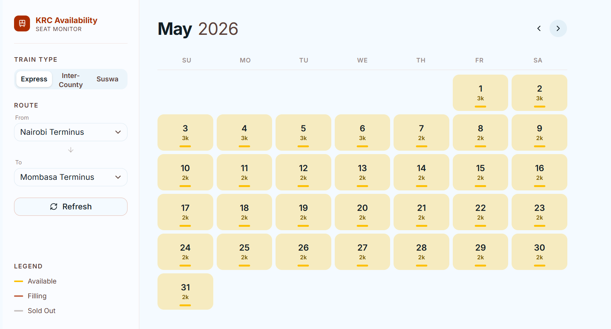
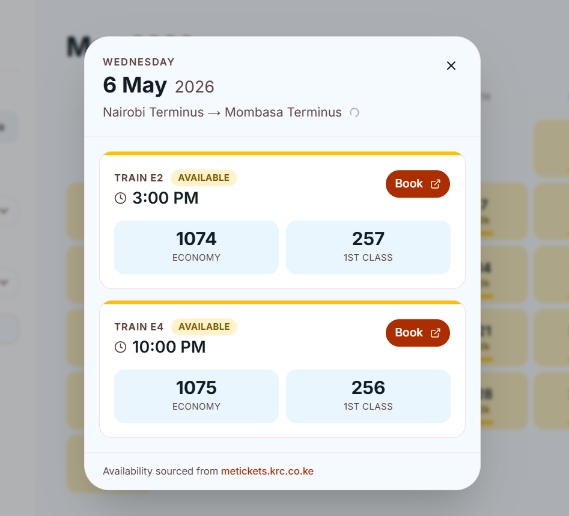

# KRC Seat Monitor

Real-time seat availability dashboard for KRC Madaraka Express trains - [metickets.krc.co.ke](https://metickets.krc.co.ke)

Pick a date to see per-train availability, fares, and a direct link to book.

## Stack

| Layer    | Tech                                                               |
| -------- | ------------------------------------------------------------------ |
| Frontend | Next.js 16 · TypeScript · Tailwind v4 · shadcn/ui · TanStack Query |
| Backend  | Express · node-cron · httpcloak · TypeScript                       |
| Database | PostgreSQL                                                         |
| Deploy   | Railway                                                            |
